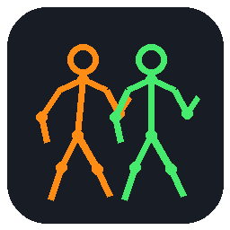

<p align="center"></p>

<h1 align="center">Universal Animator</h1>
<p align="center"><b>Make any animation fit any humanoid model.</b><br>A desktop lab that plays an animation on the character it was made for and on your model, side by side, scores the fit, shows exactly where the body strains, and fixes it with you or with your AI.</p>

> **Vibecoded.** This whole project was made by prompting an AI (Claude Code): the app, the neural network code, the installer, the packaging, and even this GitHub push. Expect rough edges. It is for non-commercial use.

## Download

Grab the latest build from the [Releases](../../releases/latest) page:

| Platform | File |
|---|---|
| Windows | `UniversalAnimationLab-Setup.exe` (installs for your account, no admin needed) |
| Linux | `UniversalAnimationLab-x86_64.AppImage` (`chmod +x`, then run) |

The Windows installer was cross-compiled and has had limited testing on real Windows machines. Please open an issue if something breaks.

## Features

**See it**
- Original character and your model play the same clip side by side
- Skeleton, X-ray, skinned-mesh and skin-weight heat map views
- Deformation view: colours the body by where it stretches, squashes or glitches
- Gap view: colours each body region by its distance from the original character
- Orbit camera and a free-fly camera (drag to look, middle-drag to pan, scroll to move, WASD and Q/E to fly, Shift for speed)
- Big side toolbar for every view, plus a reset-view button

**Judge it**
- Scores 1 to 10 stars for Viability, Aesthetic, Human-like, Flexibility, Stability, Function and Body
- Clear PASS or FAIL with the weakest category named, the worst moments, and the worst body part
- A built-in pose network (trained on about 392,000 poses) that knows what a human body can do
- Pose tests: you choose which animations to test, nothing is hard-coded
- Results window with stars and your own votes

**Fix it**
- Hot points: joints coloured by how far the network says they should move; click one to see where it should go and the chance the pose looks right, drag it or press Move it there
- Recommended changes with sliders and one-click apply
- Fix this clip and Fix everything (only changes that raise the score are kept)
- Edit layer: rotate bones per clip or for the whole model, curl fingers, undo
- Add fingers to hands that have none, with automatic skin weights
- Everything is non-destructive and shown live

**Library**
- Animation database with search, source filter and a category dropdown (Idle, Walking, Running, Jumping, Climbing, Crouching, Swimming, Combat, Weapons, Dancing, Sitting, Gestures, Vehicles, Falling)
- Add animations from a folder of BVH or keypoint files
- Add animations from a game: the built-in reverse-engineering tools study the program and your AI decodes its animations into the database

**Export and projects**
- Export the model with all fixes and the animations you choose into one folder, as a glTF with the animations embedded (30 or 60 fps, optional in-place)
- Save and open `.kami` project files (case-insensitive), Ctrl+S, and a prompt before exiting with unsaved changes

**Neural model**
- Train neural model button: rebuilds the pose database from everything you have and trains, with progress
- Library card: a record of every training run, who did it, when, and which datasets and animation sets it used
- Export neural model as a shareable `.uanet`, and choose a different neural model in Settings
- Bundled training data is kept when you train on your own sets

**AI**
- Connect your AI opens your installed CLI (Claude, Codex, Gemini, Grok) in a terminal working with the lab
- MCP server (`--mcp`) with 27 tools: screenshots returned as images, scoring, battery tests, recommendations, edits, fixing, baking, export, adding animations, training, neural model export and import, and reverse engineering
- Command line for everything the app does (`--cli`)
- Built-in reverse-engineering tools: strings, disassembly, data scanning, hex view, no outside software needed

**Everything else**
- Settings window, Apple-style dark interface, native file dialogs
- Self-contained: no Python, Blender or other tools required

## Using the MCP server

Add this to your MCP client (Settings shows the exact command for your install):

```json
{ "mcpServers": { "universal-animation-lab": { "command": "<path to the app>", "args": ["--mcp"] } } }
```

For Claude Code: `claude mcp add universal-animation-lab -- <path to the app> --mcp`

## Notes

- Non-commercial use only. The source code is not published; this repository only hosts the downloads.
- The animation library starts empty. Add your own animations from the app.
- Bundled neural-model training data is derived from several motion datasets and game animations; see `CREDITS.txt` inside the app folder.

## Credits

Trained with poses derived from LAFAN1 (Ubisoft La Forge), the Bandai Namco Research Motion Dataset, the SFU Motion Capture Database, the CMU Graphics Lab Motion Capture Database and 100STYLE. Thank you to everyone who published them.
